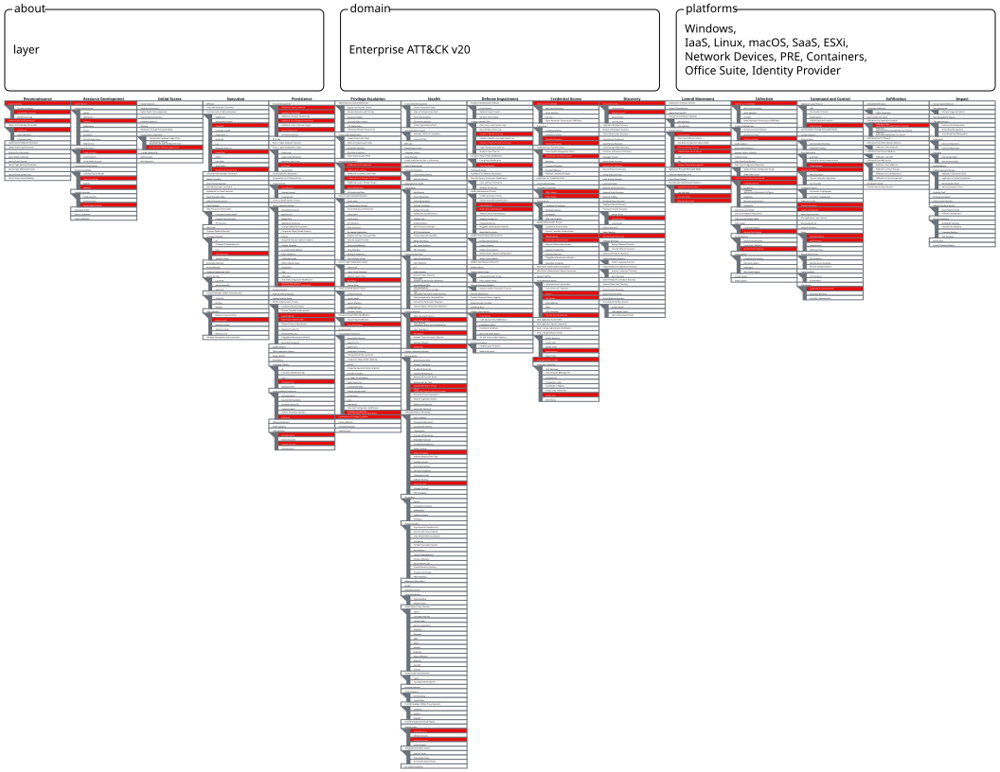

Assignment Week 10 Karabalin Bakhtiyar and Tulepbergen Beksultan

# Threat Actor Analysis: APT29 (Midnight Blizzard / Cozy Bear / NOBELIUM) — TTPs and MITRE ATT&CK Mapping

## Executive Summary

This report analyzes the tactics, techniques, and procedures (TTPs) of **APT29**, a threat group attributed by the US and UK governments to Russia's Foreign Intelligence Service (SVR). Instead of describing the group abstractly, we reconstruct **five documented operations** step by step and map every observed action to MITRE ATT&CK (group **G0016**):

1. **DNC compromise (2015)**
2. **Operation Ghost (2013–2019)**
3. **SolarWinds / SUNBURST supply-chain compromise (2019–2021)**
4. **Microsoft corporate email breach (Nov 2023 – Jan 2024)**
5. **Signed RDP-file spear-phishing campaign (Oct 2024)**

The main conclusion: APT29's tradecraft has moved from custom malware on endpoints (Dukes toolset) to **identity- and cloud-centric attacks** — stolen credentials, forged SAML tokens, malicious OAuth applications, and residential proxies — where there is often no malware for an antivirus to detect.

* * *

## 1. Why APT29

APT29 was selected because it is one of the best-documented state-sponsored groups: ATT&CK lists dozens of techniques, multiple campaigns, and public government advisories. It also covers the full spectrum we studied in earlier weeks — Windows execution and credential dumping (Week 5/9), Linux and ingress transfer (Week 6), and exposed public-facing services (Weeks 1–2).

* * *

## 2. Group Profile

| Attribute | Details |
|-----------|---------|
| ATT&CK ID | G0016 |
| Attribution | Russia's Foreign Intelligence Service (SVR); attributed publicly by the US and UK governments (April 2021 for SolarWinds) |
| Active since | At least 2008 |
| Aliases | Cozy Bear, The Dukes, CozyDuke, NOBELIUM, Midnight Blizzard, UNC2452, Dark Halo, StellarParticle, SolarStorm, YTTRIUM, IRON HEMLOCK, IRON RITUAL, Blue Kitsune, UNC3524, NobleBaron |
| Typical targets | Government networks in Europe and NATO states, research institutes, think tanks, IT / managed service providers |
| Motivation | Intelligence collection (espionage), not financial gain |
| Notable malware | MiniDuke, CosmicDuke, SeaDuke, WellMess, WellMail, SUNBURST, SUNSPOT, TEARDROP, Raindrop, GoldMax, Sibot, FoggyWeb, MagicWeb |

* * *

## 3. Campaign Analysis (Real Operations)

### 3.1 DNC Compromise (2015)

According to ATT&CK, APT29 reportedly compromised the Democratic National Committee beginning in summer 2015. This is the best-known early public case of the group and was investigated by CrowdStrike and referenced in a US government report. It shows the group's long-standing interest in political targets and its use of spearphishing and valid accounts for access.

Mapped techniques: Spearphishing (T1566), Valid Accounts (T1078).

### 3.2 Operation Ghost (September 2013 – October 2019)

ESET documented a long-running operation, which ATT&CK tracks as campaign **C0023**, in which APT29 deployed new malware strains (FatDuke, MiniDuke, RegDuke, PolyglotDuke) against government targets.

What the group did:

- Registered Twitter accounts and used them to host command-and-control nodes (**T1585.001, T1102.002**).
- Hid payloads and C2 communication inside valid images using **steganography** (**T1027.003, T1001.002**).
- Registered C2 domains crafted to look like existing legitimate domains (**T1583.001**).
- Used stolen administrator credentials for lateral movement (**T1078.002**).
- Persisted with WMI event subscriptions (**T1546.003**).

Lesson: C2 traffic was designed to look like normal social-media and image traffic, defeating signature-based network detection.

### 3.3 COVID-19 Vaccine Research Targeting (2020)

In 2020 the UK NCSC published an advisory describing APT29 targeting organizations involved in COVID-19 vaccine development. The group deployed the custom malware **WellMess** and **WellMail**, and per ATT&CK, exploited known vulnerabilities in public-facing products: **CVE-2019-19781 (Citrix)**, **CVE-2019-11510 (Pulse Secure VPN)**, **CVE-2018-13379 (FortiGate VPN)**, and **CVE-2019-9670 (Zimbra)**.

Mapped techniques: Exploit Public-Facing Application (**T1190**), External Remote Services (**T1133**), Ingress Tool Transfer (**T1105**), Develop Capabilities: Digital Certificates (**T1587.003** — self-signed certificates for mutual TLS in WellMess C2).

Relevance to our project: this is the same class of risk we studied in Weeks 1–2 — internet-exposed services found by passive reconnaissance (Shodan) are a real initial-access path for state actors, not only for opportunistic attackers. ATT&CK also lists APT29 vulnerability scanning of targets (**T1595.002**).

### 3.4 SolarWinds / SUNBURST (August 2019 – January 2021)

This is the most significant APT29 operation to date (ATT&CK campaign **C0024**, attributed to the SVR by the US and UK in April 2021).

**What happened, step by step:**

| Stage | What APT29 did | ATT&CK |
|-------|----------------|--------|
| 1. Access to the vendor | Gained access to SolarWinds' development environment; per SolarWinds, the earliest suspicious activity was in September 2019 and a test modification was made in October 2019 | T1078 |
| 2. Build tampering | Used the **SUNSPOT** implant to monitor the Orion build process and inject the **SUNBURST** backdoor into builds without changing the source repository | T1195.002 |
| 3. Signed delivery | Trojanized Orion updates released in roughly March–June 2020 were signed with SolarWinds' legitimate certificate | T1553.002 |
| 4. Dormancy and evasion | SUNBURST waited up to about two weeks before activating, then checked the environment and communicated through domains disguised as legitimate Orion traffic | T1568, T1071.001, T1036 |
| 5. Victim selection | Up to ~18,000 customers downloaded affected versions (SolarWinds' SEC filing, 14 Dec 2020), but follow-on activity was seen at a far smaller number (SolarWinds says fewer than 100) | — |
| 6. Second-stage tools | Delivered **TEARDROP**, **Raindrop**, and **Cobalt Strike** to selected victims | T1105, T1587.001 |
| 7. Discovery | Used AdFind and PowerShell (`Get-ADUser`, `Get-ADGroupMember`, `Get-AcceptedDomain`) | T1087.002, T1069.002, T1482, T1018 |
| 8. Credential access | Kerberoasting, DCSync with privileged accounts, theft of saved Chrome passwords and cookies | T1558.003, T1003.006, T1555.003, T1539 |
| 9. Lateral movement | RDP, SMB admin shares, WinRM via PowerShell, scheduled tasks created remotely | T1021.001, T1021.002, T1021.006, T1053.005 |
| 10. Identity attack | Stole AD FS token-signing certificate material and **forged SAML tokens** ("Golden SAML"); modified domain federation trust to accept tokens signed by the attacker's own certificate | T1552.004, T1606.002, T1484.002 |
| 11. Cloud persistence | Added credentials to OAuth applications and service principals; granted `company administrator` role to a new service principal; registered devices for mailbox sync | T1098.001, T1098.003, T1098.005 |
| 12. MFA bypass | Forged a `duo-sid` cookie from a stolen secret key to bypass MFA on an OWA account | T1606.001, T1550.004 |
| 13. Collection | Exported mailboxes of executives and IT staff with `New-MailboxExportRequest`; downloaded source code from code repositories and viewed internal wikis | T1114.002, T1213.003, T1213 |
| 14. Exfiltration | Compressed data with 7-Zip into password-protected archives staged on an OWA server and pulled over HTTPS | T1560.001, T1074.002, T1048.002 |
| 15. Anti-forensics | Used `AUDITPOL` to stop audit log collection, removed tools after access, timestomped backdoors, ran `Remove-MailboxExportRequest` | T1685.001, T1070.004, T1070.006, T1070.008 |

### 3.5 Microsoft Corporate Email Breach (late Nov 2023 – Jan 2024)

Microsoft disclosed on 19 January 2024 that Midnight Blizzard (APT29) had accessed some corporate email accounts, including those of senior leadership and staff in cybersecurity and legal functions.

**Attack chain, as reported by Microsoft:**

1. **Password spray against a forgotten test account.** The group used password spraying against a legacy, non-production test tenant account that did **not have MFA enabled**. The spray was deliberately slow: few attempts against a limited number of accounts to avoid lockouts, routed through **residential proxy networks** (**T1110.003, T1078.004, T1090.002**).
2. **Pivot to a legacy OAuth application.** From that foothold, the actor found a legacy test OAuth application that had elevated access to Microsoft's corporate environment (**T1078.004**).
3. **Malicious OAuth apps.** The actor created additional malicious OAuth applications and a new user account to grant them consent (**T1098.001, T1136.003**).
4. **Mailbox access.** The legacy test app was used to grant the Exchange Online `full_access_as_app` role, giving access to mailboxes without signing in as each user (**T1098.002, T1114.002, T1550.001**).
5. **Follow-on activity.** Microsoft later reported that the group used information from the stolen email to try to access more systems, including some source code repositories, and that password-spray volume rose about tenfold in February 2024 compared with January.

Microsoft found the activity by reviewing Exchange Web Services (EWS) activity and audit logs.

### 3.6 Signed RDP-File Spear-Phishing Campaign (October 2024)

Since 22 October 2024, Microsoft Threat Intelligence observed Midnight Blizzard sending highly targeted spear-phishing emails to thousands of users in over 100 organizations across government, academia, defense, and NGOs. Microsoft described the use of a **signed Remote Desktop Protocol (.rdp) configuration file** as a novel access vector for this actor.

- Emails impersonated Microsoft employees with lures about Microsoft, AWS, and Zero Trust (**T1566.001**, **T1204.002**).
- The attached `.rdp` file, signed with a Let's Encrypt certificate, connected the victim's machine to an actor-controlled server, mapping the victim's local resources (files, drives, authentication features) to that server (**T1021.001**).
- Trend Micro tracks this activity as Earth Koshchei; Microsoft, Amazon, and CERT-UA published overlapping reporting.

### 3.7 Other Notable Post-Compromise Tooling

- **MagicWeb** (reported by Microsoft in August 2022): a malicious DLL loaded into AD FS by editing `Microsoft.IdentityServer.Servicehost.exe.config`, enabling authentication as any user (**T1556.007**).
- **FoggyWeb**: a backdoor aimed at AD FS servers.
- **UNC3524** activity (Mandiant): web shells on Exchange, timestomping, RC script persistence, and use of `ApplicationImpersonation` rights to read mail (**T1505.003, T1070.006, T1037.004, T1098.002**).

* * *

## 4. Consolidated MITRE ATT&CK Mapping (by Tactic)

| Tactic | Technique | ID | Observed in |
|--------|-----------|----|-------------|
| Reconnaissance | Active Scanning: Vulnerability Scanning | T1595.002 | Pre-attack scanning of targets |
| Reconnaissance | Gather Victim Identity Information: Credentials | T1589.001 | SolarWinds |
| Resource Development | Acquire Infrastructure: Domains | T1583.001 | SolarWinds, Operation Ghost |
| Resource Development | Establish Accounts: Social Media | T1585.001 | Operation Ghost (Twitter C2) |
| Resource Development | Compromise Accounts: Cloud Accounts | T1586.003 | Residential proxies / Azure VMs |
| Resource Development | Develop Capabilities: Malware | T1587.001 | SUNBURST, TEARDROP, FatDuke |
| Initial Access | Supply Chain Compromise: Software Supply Chain | T1195.002 | SolarWinds |
| Initial Access | Phishing: Attachment / Link / via Service | T1566.001 / .002 / .003 | 2024 RDP campaign, Constant Contact lures |
| Initial Access | Exploit Public-Facing Application | T1190 | Citrix, Pulse, Fortinet, Zimbra, Exchange (CVE-2020-0688) |
| Initial Access | Valid Accounts (Cloud / Domain) | T1078, T1078.002, T1078.004 | SolarWinds, Microsoft 2024 |
| Initial Access | Trusted Relationship | T1199 | Compromise of IT/cloud providers (e.g., Mimecast certificates) |
| Execution | PowerShell / Windows Command Shell | T1059.001, T1059.003 | SolarWinds |
| Execution | Cloud API | T1059.009 | Microsoft Graph, AADInternals |
| Execution | User Execution: Malicious File | T1204.002 | Phishing campaigns |
| Persistence | Account Manipulation (cloud credentials, roles, email delegate, device registration) | T1098.001–.005 | SolarWinds, Microsoft 2024 |
| Persistence | WMI Event Subscription | T1546.003 | SolarWinds, Operation Ghost |
| Persistence | Scheduled Task | T1053.005 | SolarWinds (SUNSPOT) |
| Persistence | Create Account: Cloud Account | T1136.003 | Microsoft 2024 |
| Persistence | Modify Authentication Process: Hybrid Identity | T1556.007 | MagicWeb |
| Persistence | Server Software Component: Web Shell | T1505.003 | Exchange servers |
| Privilege Escalation | Exploitation for Privilege Escalation | T1068 | CVE-2021-36934 |
| Defense Evasion | Subvert Trust Controls: Code Signing | T1553.002 | SUNBURST signed by SolarWinds |
| Defense Evasion | Masquerading | T1036.004, T1036.005 | Task and DLL names mimicking legitimate ones |
| Defense Evasion | Obfuscated Files: Steganography / HTML Smuggling | T1027.003, T1027.006 | Operation Ghost, ISO-in-HTML phishing |
| Defense Evasion | Indicator Removal (file deletion, timestomp, mailbox data) | T1070.004, .006, .008 | SolarWinds, UNC3524 |
| Defense Evasion | Disable or Modify Tools (Windows event log, cloud log) | T1685.001, T1685.002 | `AUDITPOL`, Purview Audit disabled |
| Defense Evasion | Domain or Tenant Policy Modification: Trust Modification | T1484.002 | Federation trust abuse |
| Defense Evasion | Hide Infrastructure / External Proxy | T1665, T1090.002 | Residential proxies |
| Credential Access | Brute Force: Password Spraying / Guessing | T1110.003, T1110.001 | Microsoft 2024 |
| Credential Access | MFA Request Generation | T1621 | Repeated MFA prompts |
| Credential Access | OS Credential Dumping: DCSync / SAM / LSA | T1003.006, .002, .004 | SolarWinds, UNC3524 |
| Credential Access | Kerberoasting | T1558.003 | SolarWinds |
| Credential Access | Forge Web Credentials: SAML Tokens / Web Cookies | T1606.002, T1606.001 | Golden SAML, forged `duo-sid` cookie |
| Credential Access | Steal Application Access Token | T1528 | Token theft without passwords |
| Credential Access | Unsecured Credentials: Private Keys | T1552.004 | AD FS signing keys |
| Discovery | Account / Domain Groups / Domain Trust / Remote System Discovery | T1087.002, T1069.002, T1482, T1018 | AdFind, PowerShell |
| Lateral Movement | Remote Services: RDP / SMB / WinRM / Cloud Services | T1021.001, .002, .006, .007 | SolarWinds |
| Lateral Movement | Use Alternate Authentication Material (app token, web cookie, PtT) | T1550.001, T1550.004, T1550.003 | SolarWinds, Microsoft 2024 |
| Collection | Email Collection: Remote Email Collection | T1114.002 | SolarWinds, Microsoft 2024 |
| Collection | Data from Information Repositories: Code Repositories | T1213.003 | SolarWinds, Microsoft 2024 |
| Collection | Archive Collected Data | T1560.001 | 7-Zip archives |
| Command and Control | Web Protocols / Dynamic Resolution / Domain Fronting | T1071.001, T1568, T1090.004 | SUNBURST, HAMMERTOSS/meek |
| Command and Control | Ingress Tool Transfer | T1105 | TEARDROP, Cobalt Strike |
| Exfiltration | Exfiltration over Asymmetric Encrypted Non-C2 Protocol | T1048.002 | HTTPS pull from OWA staging |

### 4.1 ATT&CK Navigator Layer

The official Navigator layer for G0016 can be downloaded from the MITRE page and loaded into ATT&CK Navigator.



*Figure 1. ATT&CK Navigator layer for APT29 (G0016).*

* * *

## 5. Analysis of Trends

1. **From malware to identity.** Early operations (Operation Ghost, 2013–2019) relied on custom implants. SolarWinds added identity attacks (Golden SAML, OAuth service principals). The 2024 Microsoft breach used no malware at all.
2. **Abuse of trust.** Signed vendor updates (T1553.002), legitimate OAuth consent, signed RDP files, and Let's Encrypt certificates all abuse things defenders are trained to trust.
3. **Patience and stealth.** SUNBURST's dormancy period, low-volume password sprays, and use of residential proxies are all designed to stay under detection thresholds.
4. **Persistence through cloud identity.** Adding credentials to a service principal or a mail-access role survives password resets and endpoint rebuilds.
5. **Targeting is selective.** Out of up to ~18,000 SolarWinds customers that received the trojanized update, only a small number were selected for follow-on activity.

* * *

## 6. Detection Opportunities

| Behavior | Technique | Data source | Detection idea |
|----------|-----------|-------------|----------------|
| Password spray on cloud accounts | T1110.003 | Entra ID (Azure AD) sign-in logs | Many failed sign-ins across different accounts from the same ASN or IP cluster; also low-and-slow patterns over days, because residential proxies weaken IP-based blocking |
| Legacy / untested accounts without MFA | T1078.004 | Entra ID, CA policy reports | Inventory accounts excluded from MFA; alert on sign-in to tenant test accounts |
| New credentials added to a service principal or app | T1098.001 | Entra ID audit logs | Alert on "Add service principal credentials" and "Update application – Certificates and secrets management" outside change windows |
| OAuth app granted mail access | T1098.002, T1550.001 | Entra ID audit, Exchange audit | Alert on new `full_access_as_app` or `Mail.Read` application permissions and on consent granted by newly created users |
| Mailbox access by an application | T1114.002 | Exchange EWS / unified audit log | Application-only access to many mailboxes; spike in EWS calls after credential update |
| DCSync | T1003.006 | Windows Security Event 4662 | Directory replication rights used by an account that is not a domain controller |
| Kerberoasting | T1558.003 | Windows Security Event 4769 | Many service-ticket requests with RC4 encryption (0x17) by one user |
| Forged SAML tokens | T1606.002 | AD FS and Entra ID logs | Sign-in to cloud service with no matching authentication event on AD FS |
| Audit policy tampering | T1685.001 | Windows Security Event 4719 | Alert on audit policy changes (e.g., from `auditpol`) |
| Mailbox export | T1114.002, T1070.008 | Exchange admin audit log | `New-MailboxExportRequest` followed by `Remove-MailboxExportRequest` |
| `.rdp` file delivery | T1566.001, T1021.001 | Email gateway, endpoint | Block `.rdp` attachments at the mail gateway; alert on `mstsc.exe` launched with a file from email or Downloads and connecting to external IPs |
| Trojanized updates | T1195.002 | Process creation, network | Unsigned or unexpected child processes from `SolarWinds.BusinessLayerHost.exe`; DNS to unusual subdomains of newly registered domains |

Splunk search for the DCSync indicator (Event 4662, directory replication GUID):

```
index=wineventlog EventCode=4662 Properties="*1131f6aa-9c07-11d1-f79f-00c04fc2dcd2*"
| stats count by Account_Name, Computer
```

* * *

## 7. Recommendations

1. **Enforce MFA on every account**, including legacy, test, and service accounts, and prefer phishing-resistant methods (FIDO2).
2. **Inventory and review OAuth applications and service principals**; remove unused ones, limit application permissions such as mailbox access, and monitor consent grants.
3. **Protect AD FS and token-signing keys**; where possible, move to cloud authentication and monitor for forged-token patterns.
4. **Harden the software supply chain**: isolate build systems, require integrity checks on updates, and restrict outbound access from management servers like SolarWinds Orion.
5. **Collect cloud audit logs centrally** (Entra ID, Exchange, Purview audit) and alert when audit logging is disabled.
6. **Block `.rdp` attachments** and restrict outbound RDP to unapproved external hosts.
7. **Patch and reduce the attack surface of public-facing systems** (VPN, Citrix, Exchange, Zimbra); the same exposures we found during passive OSINT in Weeks 1–2 are used by this actor.
8. **Run purple-team exercises**: replicate selected APT29 techniques (for example T1110.003, T1003.006, T1558.003, T1059.001) using Atomic Red Team as in Week 9 and verify that the SIEM detects them.

* * *

## 8. Artificial Intelligence Usage

AI was used as a supporting instrument to gather and organize public reporting on APT29, structure this report, and cross-check technique IDs against the MITRE ATT&CK group page. Campaign facts and ATT&CK mappings were verified against the cited public sources by the project authors.

* * *

## Sources

- MITRE ATT&CK, APT29 (G0016): https://attack.mitre.org/groups/G0016/
  
