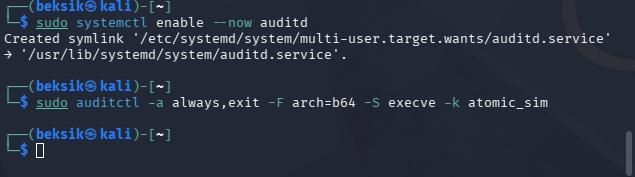
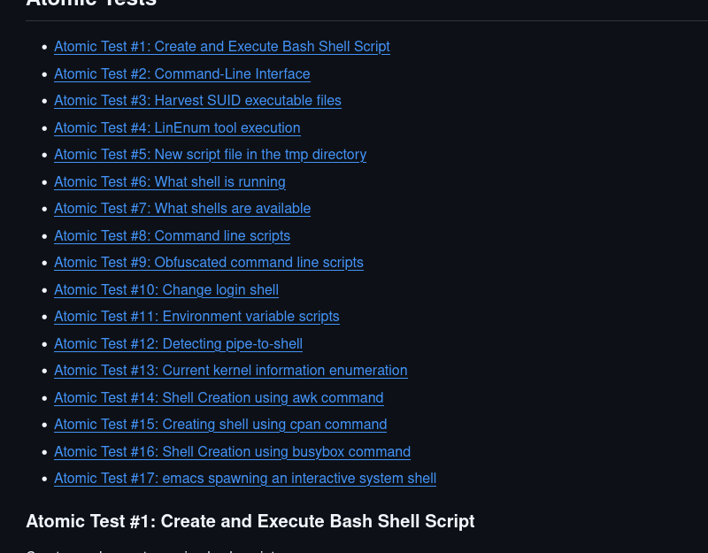
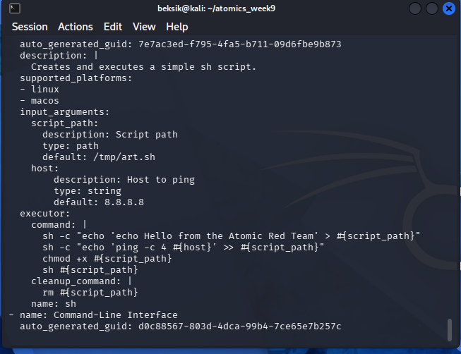
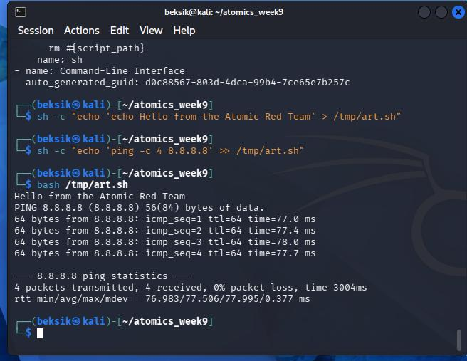
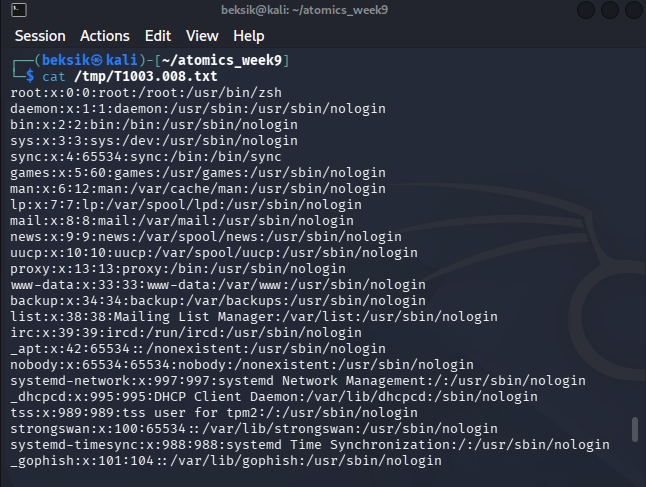
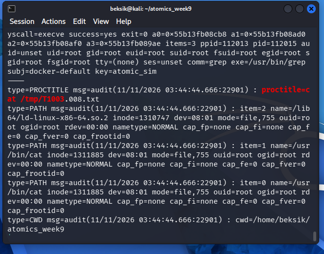
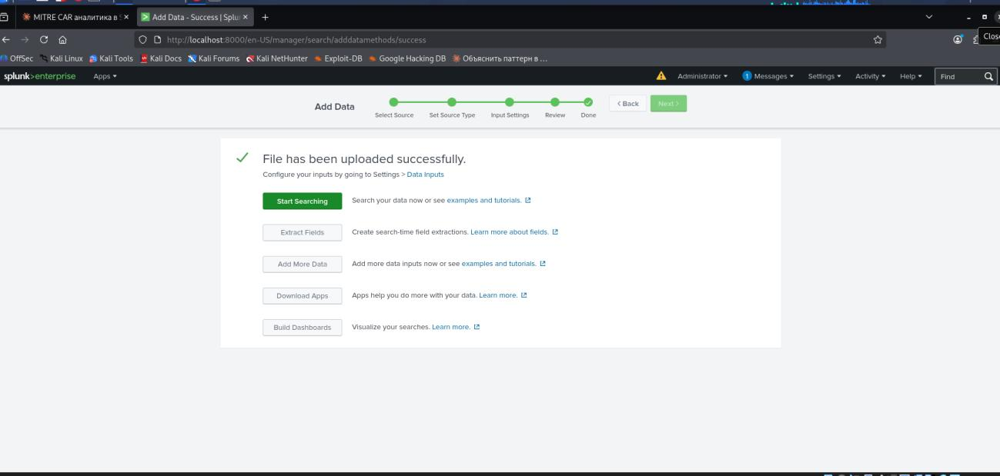
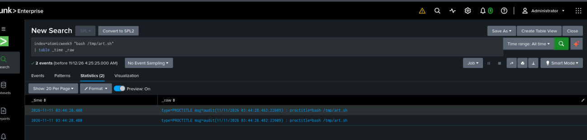
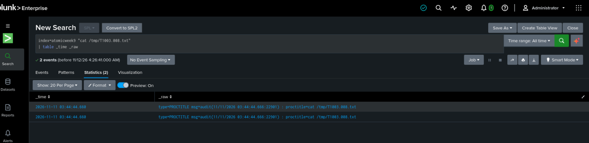

Assignment 2 Week 9 Karabalin Bakhtiyar and Tulepbergen Beksultan

# Atomic Red Team: Running and Analyzing Atomic Tests

## Executive Summary

This week's task was to run selected Atomic Red Team tests and record and analyze the results in a SIEM. Atomic Red Team (by Red Canary) is a library of small, focused tests, each mapped to a MITRE ATT&CK technique, that simulate a single piece of adversary behavior so defenders can check whether their telemetry and detections actually catch it. Two atomic tests were executed on the project's Kali Linux host: **T1059.004 (Command and Scripting Interpreter: Unix Shell), Atomic Test #1**, and **T1003.008 (OS Credential Dumping: /etc/passwd and /etc/shadow), Atomic Test #3**. Both were captured with `auditd` and analyzed in Splunk (the same Splunk instance used for the Week 5 hunt), confirming that both techniques were fully visible with a single, minimal audit rule.

* * *

## 1. Introduction to Atomic Tests

[Atomic Red Team](https://github.com/redcanaryco/atomic-red-team) is an open-source library maintained by Red Canary. Each **atomic test** is defined as a YAML entry under `atomics/<technique-ID>/` with a standard structure: `name`, `description`, `supported_platforms`, `input_arguments`, an `executor` block containing the actual `command` to run, and an optional `cleanup_command` to undo the test's side effects. Rather than installing the full PowerShell/Python execution framework, the two YAML definitions used this week were downloaded directly from the repository and their commands were run manually, exactly as written — this keeps the exercise simple and auditable.

### 1.1 Setting up telemetry (auditd)

Before running any test, `auditd` was installed/enabled and a dedicated audit rule was added so every process execution (`execve`) on the host would be tagged and searchable under the key `atomic_sim`:

```
sudo systemctl enable --now auditd
sudo auditctl -a always,exit -F arch=b64 -S execve -k atomic_sim
```


*Figure 1. `auditd` enabled and the `atomic_sim` audit rule applied.*

### 1.2 Browsing the Atomic Red Team repository

The technique page for T1059.004 on GitHub lists 17 available atomic tests for Unix Shell execution. Atomic Test #1 ("Create and Execute Bash Shell Script") was selected as the simplest, safest demonstration of T1059.004.


*Figure 2. Atomic Red Team GitHub page for T1059.004, listing all 17 available atomic tests.*

The YAML definition for this test was downloaded locally:

```
cd ~/atomics_week9
curl -o T1059.004.yaml https://raw.githubusercontent.com/redcanaryco/atomic-red-team/master/atomics/T1059.004/T1059.004.yaml
curl -o T1003.008.yaml https://raw.githubusercontent.com/redcanaryco/atomic-red-team/master/atomics/T1003.008/T1003.008.yaml
```


*Figure 3. T1059.004.yaml, Atomic Test #1 definition: `script_path` and `host` input arguments and the `executor.command` block.*

* * *

## 2. Running the Selected Atomic Tests

### 2.1 T1059.004 — Atomic Test #1: Create and Execute Bash Shell Script

Commands were run exactly as defined in the YAML's `executor.command`:

```
sh -c "echo 'echo Hello from the Atomic Red Team' > /tmp/art.sh"
sh -c "echo 'ping -c 4 8.8.8.8' >> /tmp/art.sh"
bash /tmp/art.sh
```


*Figure 4. Atomic Test #1 executed: `/tmp/art.sh` created and run with `bash`, producing the expected output and a successful ping.*

### 2.2 T1003.008 — Atomic Test #3: Access /etc/passwd (Local)

This sub-test of T1003.008 reads `/etc/passwd` without requiring `sudo` (unlike Atomic Test #1 of the same technique, which reads `/etc/shadow` and needs root), making it a safe, non-destructive choice:

```
cat /etc/passwd > /tmp/T1003.008.txt
cat /tmp/T1003.008.txt
```


*Figure 5. Atomic Test #3 (T1003.008) executed: contents of `/etc/passwd` captured to `/tmp/T1003.008.txt` and displayed.*

### 2.3 Confirming capture in auditd

Before moving the data into Splunk, the raw `auditd` log was checked locally with `ausearch` to confirm the `execve` event for the credential-access test was captured under the `atomic_sim` key:

```
sudo ausearch -k atomic_sim -i > ~/atomics_week9/atomic_sim_log.txt
```


*Figure 6. `auditd` log entry for the T1003.008 test: `type=PROCTITLE ... proctitle=cat /tmp/T1003.008.txt`, with the full `SYSCALL`/`PATH`/`CWD` context.*

* * *

## 3. Recording and Analyzing Results in Splunk

The collected `auditd` log (`atomic_sim_log.txt`) was uploaded into Splunk as a new source type and index (`atomicweek9`), via **Settings → Add Data → Upload**.


*Figure 7. `atomic_sim_log.txt` successfully uploaded into Splunk under index `atomicweek9`.*

Two searches (time range: **All time**) were run to confirm each technique's telemetry was indexed and searchable:

**Query 1 — T1059.004:**
```
index=atomicweek9 "bash /tmp/art.sh"
| table _time _raw
```


*Figure 8. Splunk search confirming the `bash /tmp/art.sh` execution event (T1059.004) is indexed and searchable.*

**Query 2 — T1003.008:**
```
index=atomicweek9 "cat /tmp/T1003.008.txt"
| table _time _raw
```


*Figure 9. Splunk search confirming the `cat /tmp/T1003.008.txt` execution event (T1003.008) is indexed and searchable.*

* * *

## 4. Mapping Results to ATT&CK

| # | Atomic Test | Technique | Tactic | Command | Evidence |
|---|---|---|---|---|---|
| 1 | T1059.004 — Atomic Test #1 | Command and Scripting Interpreter: Unix Shell | Execution | `bash /tmp/art.sh` | Figures 4, 6, 8 |
| 2 | T1003.008 — Atomic Test #3 | OS Credential Dumping: /etc/passwd and /etc/shadow | Credential Access | `cat /etc/passwd > /tmp/T1003.008.txt` | Figures 5, 6, 9 |

* * *

## 5. Findings

1. A single, minimal `auditd` rule (`-S execve -k atomic_sim`) was sufficient to capture both tests end to end, from Execution (T1059.004) through Credential Access (T1003.008), without any technique-specific tuning.
2. T1059.004 produces a very distinctive process chain (`sh -c ... > /tmp/art.sh` followed by `bash /tmp/art.sh`), which is cheap and reliable to detect.
3. T1003.008's read of `/etc/passwd` is low-noise and specific; the sibling test reading `/etc/shadow` would be an even stronger signal, since it additionally requires `sudo`/root privileges.
4. Running the atomic tests manually (rather than through the full PowerShell/Python Invoke-AtomicTest framework) kept the exercise simple while still reproducing the exact commands published by Red Canary.
5. Splunk successfully indexed and surfaced both events once uploaded, confirming the Linux host → auditd → Splunk pipeline built in earlier weeks (Week 5, Week 6) still works for new technique categories.

* * *

## 6. Recommendations

1. Build on these raw searches by saving them as Splunk alerts (as in Week 7), so future atomic test runs trigger automatically instead of requiring a manual search.
2. Extend coverage to further T1059.004 atomic tests (e.g., Test #9, obfuscated command-line scripts) to validate detection against lightly disguised commands.
3. For T1003.008, add a correlation rule that also flags access to `/etc/shadow` specifically, since that sub-test requires elevated privileges and is a stronger indicator of malicious intent.
4. Forward `auditd` logs continuously (rather than one-off file uploads) so atomic test runs are visible in near-real time, consistent with the Splunk pipeline used in Weeks 5–7.

* * *

## 7. Artificial Intelligence Usage

AI was used to identify suitable, safe atomic tests from the Atomic Red Team repository, help structure the `auditd`/Splunk workflow, and assist with report formatting. All command execution, log collection, Splunk configuration, and screenshot capture were performed by the project authors on their own Kali Linux host.

* * *

## Sources

- Atomic Red Team GitHub repository (github.com/redcanaryco/atomic-red-team): T1059.004, T1003.008.
- Red Canary, Atomic Red Team documentation (atomicredteam.io).
- MITRE ATT&CK (attack.mitre.org): T1059.004, T1003.008.
